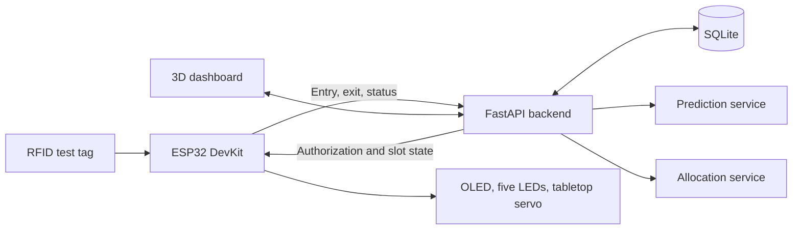

# Smart Parking System Architecture

## Purpose

This repository implements a five-space smart parking prototype. The operating workflow uses an ESP32 controller, RC522 RFID reader, SSD1306 OLED, five indicator LEDs, a supervised tabletop servo, FastAPI, SQLite, prediction models, allocation algorithms, and a browser dashboard. Occupancy is the state of confirmed RFID vehicle sessions.

## System Context

The local computer coordinates requests, persistence, prediction, allocation, and dashboard state. The controller performs tag reads, validates API responses, updates indicators, and actuates the supervised demonstration gate only after confirmed authorization.

## Component Boundaries

### ESP32 controller

- Reads and normalizes RFID UIDs without logging them.
- Sends idempotent entry and exit requests.
- Updates the OLED and five slot LEDs from confirmed server status.
- Opens the tabletop servo only after a valid committed response; failure leaves it closed.

### FastAPI backend

- Owns the vehicle lifecycle, parking status, prediction, allocation, and dashboard APIs.
- Keeps entry, slot assignment, and exit updates atomic in SQLite.
- Derives slot occupancy from active parking sessions.

### Prediction service

- Builds shared chronological sequences for LSTM, GRU, and temporal Transformer comparisons.
- Validates model artifact hashes and uses a deterministic baseline when needed.

### Allocation service

- Shares the objective across NSGA-II, GA, PSO, ACO, first-available, and exact enumeration.
- Excludes occupied slots and returns the selected free slot with metrics.

### Persistence and dashboard

SQLite is the system of record for slots, vehicles, parking sessions, context samples, allocations, optimizer runs, and prediction records. The dashboard consumes server status and event-stream APIs; the 3D scene animates the confirmed assignment and exit.

## Primary Data Flows

### Entry

1. The controller reads a tag and requests current status.
2. It submits an idempotent entry request.
3. The backend verifies that the vehicle is not already parked, selects a free slot, and commits the session and allocation together.
4. The response confirms the slot and authorizes one tabletop gate cycle.
5. The controller updates the OLED and the assigned slot LED; the dashboard animates the vehicle into that slot.

### Exit

1. The controller reads the parked vehicle's tag and submits an idempotent exit request.
2. The backend closes the active session and releases its assigned slot atomically.
3. The controller turns off the slot LED and performs one authorized gate cycle.
4. The dashboard animates the vehicle leaving and reconciles the free slot state.

### Forecast and comparison

Historical context, sessions, and allocations are converted into shared time-series sequences. Forecasting and allocation endpoints expose their comparisons to the dashboard. Synthetic experiment results are identified separately from physical controller observations.

## API Boundary

- `GET /health`
- `GET /api/parking/status`
- `POST /api/vehicle/entry`
- `POST /api/vehicle/exit`
- `GET /api/parking/events/stream`
- `POST /api/parking/hardware-events`
- `GET /api/prediction`
- `POST /api/allocation/run`
- `GET /api/benchmarks/optimizers`
- `GET /api/benchmarks/predictors`
- `GET /dashboard`

## Configuration and Deployment

- `config/parking.yaml` defines slot metadata, scene routes, and allocation weights.
- The backend runs on a local computer with SQLite on local storage.
- Firmware receives local Wi-Fi credentials and API URL through private configuration; secrets are not committed.
- The controller communicates over a trusted local network.
- Hardware measurements distinguish recorded observations from quantities still marked `NOT TESTED`.

## Quality Attributes

- **Safety:** failed or uncertain transactions leave the gate closed; occupied slots are not reassigned.
- **Determinism:** demo data and optimizer benchmarks use fixed seeds.
- **Resilience:** retries reuse idempotency keys and dashboard state reconciles with the backend.
- **Comparability:** algorithms share inputs, constraints, objectives, and metrics.
- **Demoability:** software lifecycle and dashboard operate without physical hardware.
