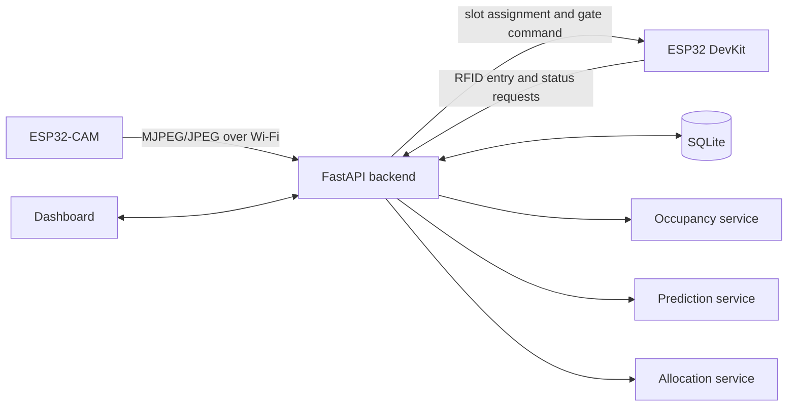

# Smart Parking System Architecture

## Purpose

This repository will implement a smart parking system whose initial physical
prototype has five slots. Slot cardinality is configuration-driven in the
backend so other deployments can operate on any non-empty slot set. The system
combines ESP32 hardware, camera-based occupancy detection, predictive models,
and multi-objective slot allocation, and must run end to end without physical
hardware so development and demonstrations remain repeatable.

The detailed product and implementation requirements are in [`2026-09-03-smart-parking-design.md`](2026-09-03-smart-parking-design.md). This document is the concise architectural reference.

## System Context



The laptop/server is the system coordinator. The embedded devices collect input and actuate physical outputs, while all compute-heavy work and persistent state remain on the server.

## Component Boundaries

### ESP32-CAM

- Connects to configured Wi-Fi.
- Provides an MJPEG stream and/or JPEG snapshot endpoint.
- Reports health without performing ML inference.
- Uses a fixed camera position so configured slot regions remain stable.

### ESP32 DevKit controller

- Reads RC522 RFID UIDs and submits vehicle entry requests.
- Displays the returned assignment on an OLED.
- Drives five slot LEDs and the SG90 entry-gate servo.
- Keeps the gate closed when the response is missing or invalid.
- Retries transient network failures with capped backoff.

### FastAPI backend

- Owns the public HTTP API and dashboard.
- Coordinates vehicle sessions, occupancy, prediction, and allocation.
- Enforces invariants such as never assigning an occupied slot.
- Stores domain state, observations, and experiment results in SQLite.

### Occupancy service

- Crops one configurable Region of Interest per configured slot from each frame.
- Supports a deterministic image heuristic and an optional Keras CNN.
- Applies confidence thresholds and temporal smoothing.
- Persists only accepted state changes; a single failed or uncertain frame does not flip state.

### Prediction service

- Builds identical time-series splits and features for all models.
- Compares LSTM, GRU, and temporal Transformer models using MAE, RMSE, MSE, and inference latency.
- Validates artifact hash, manifest, split, feature, geometry, and scaler
  compatibility before loading a selected artifact.
- Uses a deterministic baseline when no compatible trained artifact exists.

### Allocation service

- Exposes one cost interface shared by Genetic Algorithm, Particle Swarm Optimization, and Ant Colony Optimization implementations.
- Calculates the configurable weighted cost from walking distance, congestion, waiting contribution, and fairness.
- Returns the chosen slot, cost, iterations, latency, and objective breakdown.
- Benchmarks all algorithms against identical scenarios and deterministic test seeds.

### Persistence

SQLite is the initial system of record. The planned tables are `parking_slots`,
`occupancy_events`, `vehicles`, `parking_sessions`, `context_samples`,
`allocations`, `optimizer_runs`, and `prediction_runs`. Database initialization
seeds the configured slots and their walking-distance and zone metadata; the
committed demo configuration contains five.

## Primary Data Flows

### Vehicle entry

1. The controller reads an RFID UID and calls `POST /api/vehicle/entry`.
2. The backend validates the vehicle and obtains the latest accepted occupancy state.
3. The selected optimizer ranks only free slots using the configured objective weights.
4. The backend persists the allocation and session, then returns the assigned slot and gate action.
5. The controller displays the slot, activates its LED, and performs the safe gate cycle.

### Occupancy update

1. The camera supplies a frame to the server.
2. The occupancy service evaluates each configured ROI.
3. Temporal smoothing accepts or rejects each candidate transition.
4. Accepted changes update the current slot state and append occupancy events.
5. API consumers and the dashboard observe the updated state.

### Forecast and comparison

1. Historical occupancy and contextual data are converted into shared sequences.
2. LSTM, GRU, and Transformer models use the same data splits.
3. Metrics and latency are persisted for comparison.
4. The runtime endpoint serves the configured model or deterministic fallback.

## API Boundary

The initial API consists of:

- `GET /health`
- `GET /api/parking/status`
- `POST /api/vehicle/entry`
- `POST /api/vehicle/exit`
- `POST /api/camera/occupancy`
- `GET /api/prediction`
- `POST /api/allocation/run`
- `GET /api/benchmarks/optimizers`
- `GET /api/benchmarks/predictors`
- `GET /dashboard`

Request and response schemas must be defined explicitly and shared by the API and tests. Hardware endpoints must tolerate retries without creating duplicate active sessions or allocations.

## Configuration and Deployment

- Environment variables select hardware or demo mode and hold network/runtime settings.
- `config/parking.yaml` owns slot metadata, optimizer weights, timing, and thresholds.
- `config/rois.example.json` documents one camera region per demo slot; a local calibrated ROI file is not committed.
- The backend initially runs as one process on a laptop/server with SQLite stored on a persistent local volume.
- Firmware contains no backend secrets and receives the backend URL and Wi-Fi credentials through local configuration.

## Quality Attributes

- **Safety:** the gate fails closed and occupied slots cannot be assigned.
- **Determinism:** tests, demo data, and optimizer benchmarks use controlled seeds.
- **Resilience:** missing model artifacts, uncertain frames, or disconnected hardware degrade to documented fallbacks.
- **Comparability:** all competing algorithms receive the same data, objectives, scenarios, and metrics.
- **Replaceability:** vision modes, predictors, and optimizers share stable service interfaces.
- **Demoability:** every backend flow works with simulated camera and RFID input.

## Planned Repository Areas

```text
backend/       FastAPI application, persistence, domain schemas, dashboard
vision/        capture, ROI detection, classifier training, dataset tools
prediction/    preprocessing, model training, evaluation, comparison
optimization/  fitness function, GA, PSO, ACO, benchmark runner
firmware/      ESP32 controller and ESP32-CAM sketches
config/        versioned example and default configuration
scripts/       demo seeding and end-to-end demo commands
tests/         unit and integration tests
docs/          detailed specifications and future implementation plans
```

## Architectural Constraints

- Version 1 ships a five-slot prototype while backend slot cardinality remains configuration-driven.
- Heavy vision and prediction inference does not run on either ESP32.
- The dashboard uses server-rendered/static HTML, CSS, and JavaScript without a frontend framework.
- Hardware integration must be enabled through configuration, not source changes.
- New algorithms must plug into the shared comparison interfaces rather than bypass them.
