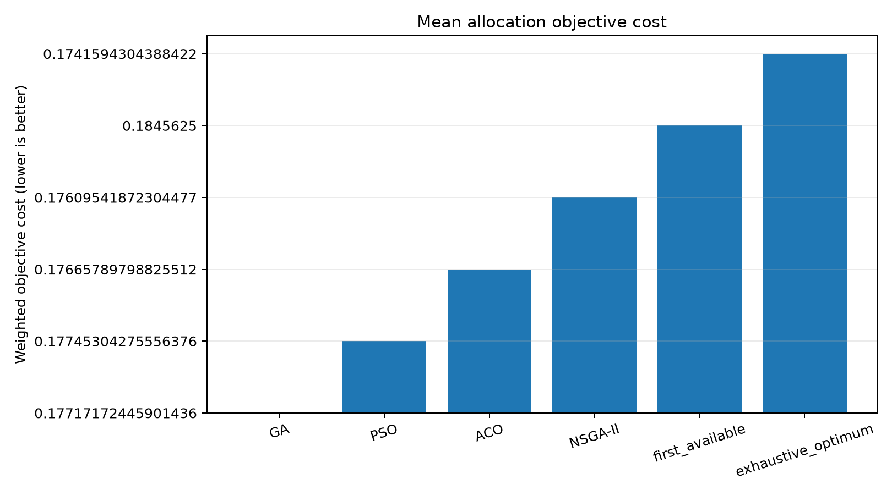
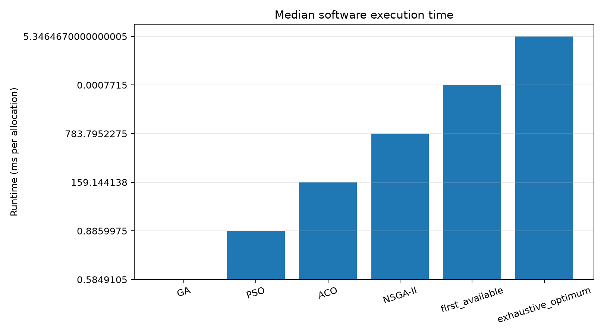
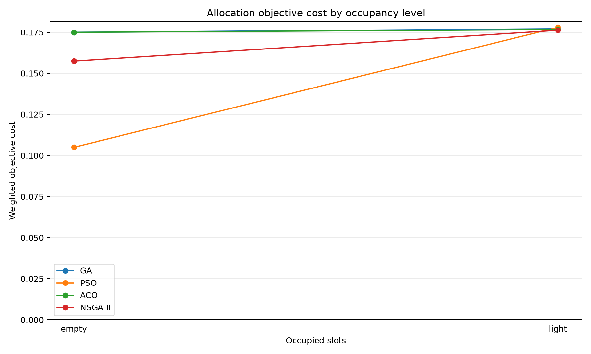
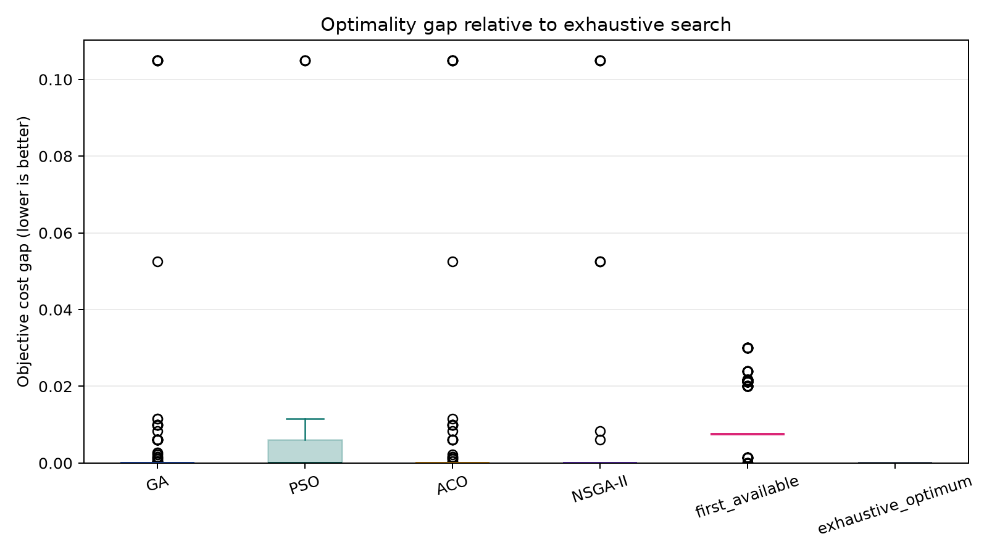
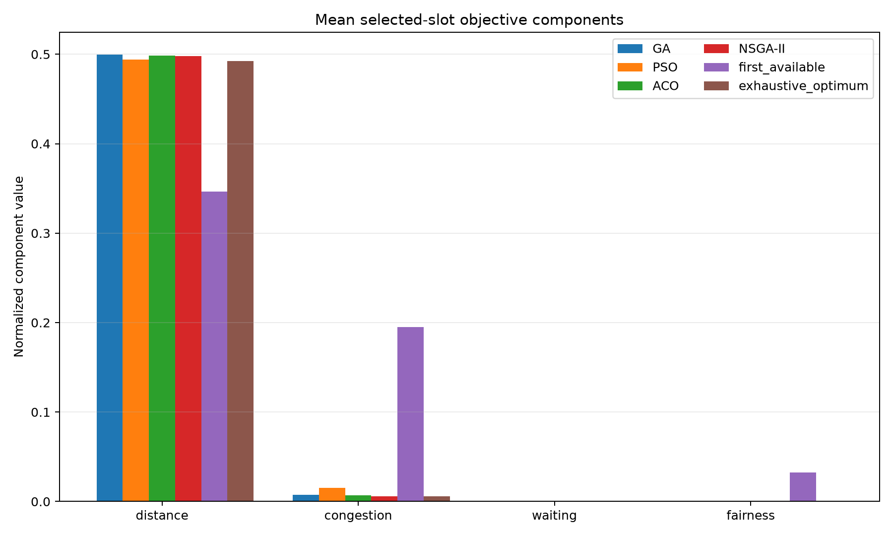
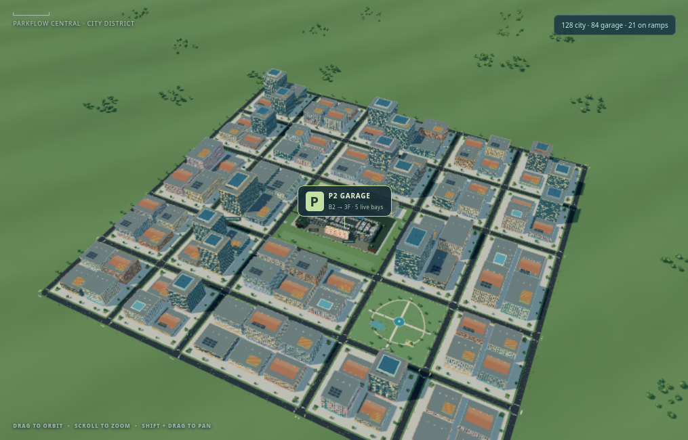
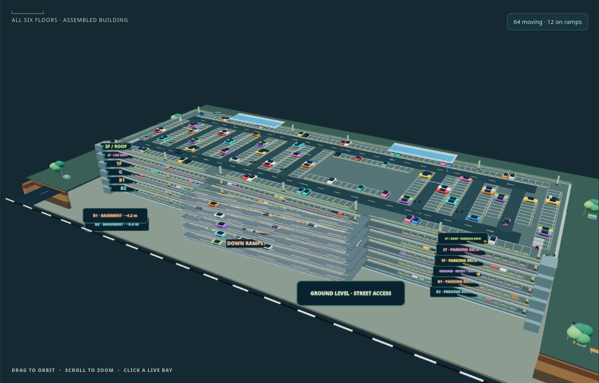
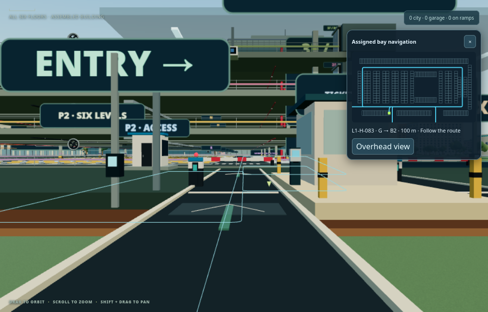
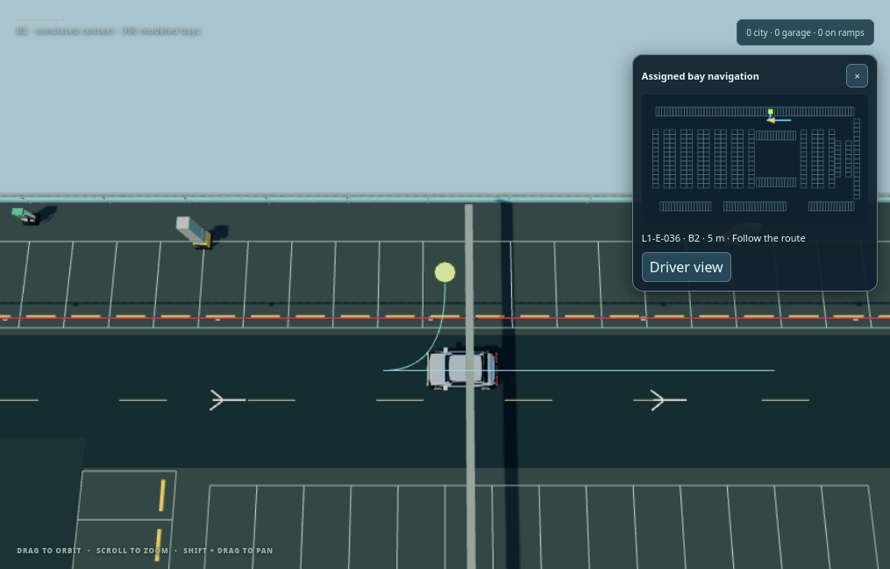

# Experimental report — Smart Parking review

Generated from local executed outputs. Forecasting observations are synthetic; optimizer scenarios come from parking allocations captured during an executed SUMO/TraCI run.

## Dataset

The exported feature timeline contains 4,032 five-minute buckets and 27 model features over 2026-08-01T00:00:00Z to 2026-08-14T23:55:00Z. The raw export contains 6,274 privacy-safe source records. Seed: `20260908`.
Google Drive dataset ZIP: [download](https://drive.google.com/file/d/1-bgCGNuCgbhWTbKyxnMlLpOQH1s3lxSZ/view?usp=drivesdk) (read-only access for `vit.ac.in`).

Training sequences: {'test': 594, 'train': 2810, 'validation': 592}. Continuous variables are standardized using training data only. The unchanged prediction contract uses a 12-bucket lookback and next-bucket target.

The generator is simulated. It does not represent measured weather, site demand, physical waiting times, or parking throughput.

## Prediction experiments

All models share the same prepared dataset and untouched chronological test split. The persistence baseline predicts that the most recent occupancy ratio continues for one interval. Latency is measured per prediction in this server process.

| Model | MAE | MSE | RMSE | Median latency (ms) | Model size (bytes) |
| --- | ---: | ---: | ---: | ---: | ---: |
| persistence_baseline | 0.120875 | 0.028620 | 0.169173 | 0.000015 | N/A |
| lstm | 0.104062 | 0.016818 | 0.129685 | 0.245910 | 60481 |
| gru | 0.098055 | 0.013891 | 0.117862 | 0.223783 | 52615 |
| transformer | 0.109173 | 0.018098 | 0.134531 | 0.232451 | 110684 |

Lowest measured MAE: **gru** (0.098055). This ranking applies to the generated data and this execution environment only.

Artifacts were reloaded and hash/manifest checked. The configured `/api/prediction` endpoint returned neural predictions without fallback for each family. These are server-side results; no ESP32 or other microcontroller inference was measured.
Model ZIP with weights, manifests, results, and checksums: [download](https://drive.google.com/file/d/1I1ECMeYlJT9-oop4Bh-Qedgti9Kds6lj/view?usp=drivesdk) (read-only access for `vit.ac.in`).

## Allocation optimizer experiments

The benchmark captured 120 SUMO-observed parking allocation states from TraCI arrivals, then ran each optimizer with 3 repeat seeds per observed state. It used the configured weights `{"congestion": 0.3, "distance": 0.35, "fairness": 0.15, "waiting": 0.2}`; GA, PSO, and ACO used 30 iterations, while NSGA-II used population 48, 60 generations, crossover 0.90, and mutation 0.12. SUMO Eclipse SUMO sumo 1.28.0 used seed 20261031 and 0.25 second steps; captured arrivals spanned simulation seconds 0.50 to 367.25. Configuration, network, and route SHA-256 hashes are recorded in `optimization_results/optimizer_summary.json`. Across the compared runs, 0 full-capacity attempts were observed. Candidate snapshots and their objective values are preserved in `optimization_results/sumo_observed_scenarios.jsonl`.

| Algorithm/reference | Successful runs | Success rate | Mean cost | Runtime mean / median / SD (ms) | Mean optimality gap | Invalid assignments |
| --- | ---: | ---: | ---: | ---: | ---: | ---: |
| first_available | 360 | 1.000 | 0.184562 | 0.000787 / 0.000772 / 0.000200 | 0.010403 | 0 |
| exhaustive_optimum | 360 | 1.000 | 0.174159 | 5.402643 / 5.346467 / 0.488597 | 0.000000 | 0 |
| GA | 360 | 1.000 | 0.177172 | 0.592322 / 0.584910 / 0.049935 | 0.003012 | 0 |
| PSO | 360 | 1.000 | 0.177453 | 0.898942 / 0.885997 / 0.072784 | 0.003294 | 0 |
| ACO | 360 | 1.000 | 0.176658 | 160.767959 / 159.144138 / 9.061569 | 0.002498 | 0 |
| NSGA-II | 360 | 1.000 | 0.176095 | 758.596394 / 783.795228 / 69.617389 | 0.001936 | 0 |

Lowest mean objective cost among successful policies: **exhaustive_optimum** (0.174159). Exhaustive enumeration is the exact single-slot optimum for each 2,376-candidate observed state; first-available is a simple deterministic selection policy, not FCFS queue scheduling.

These are measured optimizer outcomes and Python runtimes from the recorded SUMO execution. Each case uses the live allocation request captured at an actual simulated parking admission, including its occupied slots, zone congestion, configured bay distances, and per-identity fairness history; exact search supplies the reference for that same state. The results represent this fictional-garage SUMO run, not a measured real facility or physical throughput. Waiting cost remains zero because the live allocator does not measure queue delay.

### Optimizer graphs

## Current dashboard and parking workflow

The browser renders a fictional six-level garage and city connected to SUMO/TraCI. The garage contains 2,376 modeled bays across six 396-bay decks: two below ground and four above ground, joined by ramps. Published Haneda P2 floor guides inform the geometry; the basement and city are emulations, not an exact map of Phoenix Marketcity or Haneda. Roads, buildings, landscaping, trees, pedestrians, street lights, signals, moving traffic, gates, and ramps are part of the animated scene. The five RFID-equipped spaces remain the physical prototype; every modeled bay has a software occupancy record.

SUMO controls include start, stop, pause, resume, and reset, with live simulated time, vehicle count, mean speed, and parking event updates. Each SUMO vehicle ID maps to a stable pseudonymous parking identity across simulation runs, with run-specific idempotency keys for entry, exit, and rollback. Road vehicles arriving at the garage enter a session, leave the road flow while parked, then exit the session and rejoin traffic after an emulated dwell. Admission is limited to two vehicles per simulation step. This is controlled software traffic, not measured facility throughput.

Vehicle entry supports a connected RFID reader or manual ID simulation through the same API. UIDs are normalized into unique vehicle identities, with at most one active session per identity and separate records for repeat visits. Entry follows a first-person route to the assigned floor/bay and marks the destination on a parking map; exit releases the bay and animates departure. The dashboard displays a QR-linked receipt with identity, bay, timestamps, duration, tariff, and amount. It provides a live estimate while parked and a final charge at exit; it does not accept payment or settle a transaction.

The demo tariff is ₹50 for the first started hour, ₹40 per additional started hour, the first 10 minutes free, and ₹400 maximum per 24 hours. It is an illustrative rule, not a verified mall tariff. RFID identity keeps vehicle/session history distinct but does not change the tariff. Live allocation includes personalized fairness: each candidate bay is scored by the absolute difference between that vehicle's projected mean walking distance after assignment and the equal-weighted mean of each other vehicle's historical mean walking distance across completed sessions. Stable SUMO identities preserve this history across simulation runs. The score uses configured bay distances, is neutral at zero when there is no peer history, and is capped from 0 to 1. Waiting remains zero because the model does not measure queue wait. This is an allocation proxy, not a guarantee of equitable outcomes. The optimizer benchmark uses allocation states captured from the executed SUMO/TraCI run; its conclusions apply to this modeled traffic run, not a field-measured parking facility.

The 3D captures below document the modeled city, garage, and navigation views. They are interface evidence, not measured traffic outcomes.

## Hardware status and engineering estimates

The latest post-rewire tabletop validation record captures two RFID reads and two successful entry/exit API transactions (2/2 HTTP 200). It also records the S1 occupancy transition. Physical LED visibility, OLED behavior, servo motion, and current draw were not independently verified. Two earlier RC522 SPI probes returned 0xFF and 0x00 before rewire; they do not describe the latest successful reads. Two trials are insufficient to infer a reliability rate.

The following are rough engineering planning estimates, not hardware measurements or simulated benchmark results. Success-rate and latency ranges are low-confidence analyst assumptions for close-range tabletop use on a stable local Wi-Fi network. Replace them with trial data before making performance claims. Component values use the firmware and manufacturer specifications where available.

| Quantity | Rough estimate | Basis and limitation |
| --- | ---: | --- |
| RFID successful reads per close, aligned tap | 90-99% (very low confidence) | Assumes a supported tag within about 20 mm, stable 3.3 V, and no nearby metal. MFRC522 specifies up to 50 mm depending on antenna tuning; this is not a success-rate guarantee ([NXP datasheet](https://www.nxp.com/docs/en/data-sheet/MFRC522.pdf)). |
| API entry/exit transaction success on stable LAN | 98-99.5% (very low confidence) | Planning assumption for healthy Wi-Fi and backend; no post-rewire trial series was captured. |
| LED correctness with known slot state | 95-100% (very low confidence) | Assumes correct wiring/polarity and status refresh; no expected-versus-observed trials. |
| Entry/exit latency, tag detection to accepted response | 0.2-1.0 s (low confidence) | Order-of-magnitude estimate for one local request and SQLite transaction. Firmware's 3.5 s HTTP timeout is a failure limit, not expected latency. |
| Wi-Fi recovery after AP is available | 5-15 s (low confidence) | Firmware retries every 5 s; range allows up to 10 s association/DHCP after retry. |
| Servo command delay after RFID detection | 0.2-1.0 s (low confidence) | Assumes one healthy local API round trip; excludes mechanical travel. |
| SG90 10°→85° travel | 0.13-0.50 s (very low confidence) | Nominal ideal is 125 ms from 75° x 0.1 s/60° at 4.8 V; upper range adds load/settling allowance ([TowerPro](https://towerpro.com.tw/product/sg90-7/)). |
| Controller free heap | Measured historical mean 274,069 bytes (n=8) | Captured serial telemetry during earlier controller runs; median 292,240, SD 26,019, p95 293,416 bytes. This is measured, not an estimate. |
| Controller + reader + OLED + LEDs input current, servo excluded | 0.15-0.40 A at 5 V (very low confidence) | Budget estimate from ESP32 active Wi-Fi current plus peripheral allowance; regulator and duty cycle vary ([Espressif datasheet](https://documentation.espressif.com/esp32_datasheet_en.html)). |
| SG90 servo supply current | 0.5-2.0 A (very low confidence) | Manufacturer product page notes this range; exact servo/load is unknown. Use separate regulated supply ([TowerPro](https://towerpro.com.tw/product/sg90-7/)). |

The probability and performance ranges above are assumptions for planning, not confidence intervals from data. Captured physical free-heap samples and API responses remain identified separately as measured observations in `output/hardware/`; simulated API and optimizer runtimes remain software-only results. Current estimates are per separate rail and must not be added as if measured simultaneously.

## Reproduction and outputs

Run `make review` to regenerate the dataset, ML artifacts and metrics, verified model ZIP, optimizer tables and figures, and this report. See `REPRODUCE.md` for individual commands.
